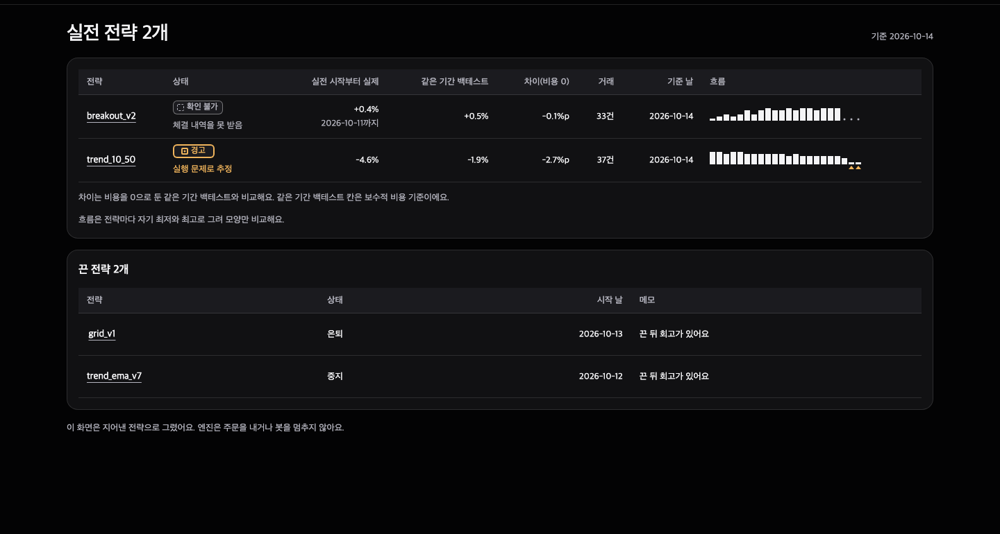

[English](README.md) | 한국어

# BlackClip Guardrail

BlackClip Guardrail은 맥용 로컬 도구예요. AI와 함께 만든 매매 전략으로 봇을 돌리고 있다면 거래소 키 없이 봇이 남기는 기록을 지켜보다가 기록이 끊기면 텔레그램으로 깨워 줘요. 실전에 넣기 전 점검과 백테스트 대조도 해요.

BlackClip은 개인 투자자가 결정하기 전에 한 번 더 확인하는 도구 모음이에요.

- [Research](https://research.blackclip.app): 이 투자 아이디어를 믿어도 될까?
- [Guardrail](https://guardrail.blackclip.app): 이 전략을 실제 돈으로 돌려도 될까?
- [Hedge](https://hedge.blackclip.app): 지금 가진 위험을 현실적으로 얼마나 줄일 수 있을까?

브랜드 사이트는 [blackclip.app](https://blackclip.app)이에요.

[샘플 대시보드](https://guardrail.blackclip.app/demo/)를 1440px로 찍은 화면이에요. 지어낸 전략 넷으로 그린 읽기 전용 화면이라 설치 없이 먼저 볼 수 있어요. 화면, 명령, 텔레그램 알림은 지금 한국어만 있어요.

## 무엇을 하나요

- **봇 지켜보기(키 없이)**: 돌고 있는 봇이 이미 남기는 기록 파일을 읽어요. 기록이 정한 시간(예: 90분)보다 오래 끊기면 텔레그램으로 「봇이 안 보여요」를, 다시 들어오면 「봇이 다시 보여요」를 보내요.
- **점검**: 실전에 넣기 전에 재현성 · 미래참조 · 거래비용 · 시도 수 · 국면을 봐요. 그 전략에 맞는 가드레일(정상 범위와 경고선)도 만들어요.
- **대조(고를 때만)**: 실제 계좌와도 맞대 보고 싶으면 조회 전용 키로 체결을 받아요. 같은 기간 백테스트와 매일 맞춰 보고 벗어나면 텔레그램으로 알려 줘요.
- **회고**: 이미 봇을 돌리고 있었다면 지난 석 달 체결로 「첫 회고」 한 장부터 보여 줘요.

## 하지 않는 것

- 주문을 내지 않아요. 경고만 하고 봇을 멈추지도 않아요. 멈출지는 직접 정해요.
- 봇 코드를 고치지 않아요. 봇이 남기는 기록을 읽기만 해요.
- 주문이나 출금 권한이 켜진 키는 저장하지 않아요.
- 투자 자문이 아니에요. 점검 결과 · 가드레일 · 경고는 참고용 숫자이고, 수익을 보장하지 않아요.

## 필요한 것

- macOS: 예약 작업에 launchd를 써요.
- [uv](https://docs.astral.sh/uv/): 파이썬 3.11 이상은 uv가 받아 줘요.
- [Claude Code](https://claude.com/claude-code): 봇 기록을 이벤트로 바꾸는 어댑터와 전략 연결 파일을 만들 때 필요해요. 다른 명령도 대신 돌리고 결과를 설명해 줘요.
- 텔레그램 계정(알림을 받으려면)
- 바이낸스 **조회 전용** API 키(현물과 선물): 실제 계좌와 맞대 볼 때만 필요해요.

## 설치

엔진(`blackclip` 명령):

    uv tool install blackclip-guardrail
    blackclip --version

`blackclip`을 못 찾는다고 나오면 `uv tool update-shell`을 돌리고 새 터미널을 열어요.

Claude Code 플러그인(스킬 하나와 훅 넷). 전략 레포 폴더에서 Claude Code를 열고(Claude Code 2.1.275 이상):

    /plugin install blackclip-guardrail --marketplace https://github.com/Noah-TaeHwan/blackclip-guardrail.git

터미널에서는 같은 일을 이렇게 해요(Claude Code 2.1.292 이상):

    claude plugin install blackclip-guardrail --marketplace https://github.com/Noah-TaeHwan/blackclip-guardrail.git --scope project

`--scope project`로 넣으면 그 레포에서만 돌아요. 기본값(user)은 모든 폴더에서 훅이 돌아요. 퀀트 레포처럼 보이지 않는 폴더에서는 첫 셋업 안내를 내지 않아요.

## 처음 10분: 돌리던 봇에 키 없이 붙이기

전략 레포 폴더에서 Claude Code를 열고 「봇 지켜봐 줘」라고 해요. 이 순서로 가요.

1. 봇과 기록 찾기: `blackclip scan .`으로 폴더를 실행 없이 훑어요. 봇 코드에서 봇이 덧붙여 쓰는 기록 파일(로그 · jsonl · csv)을 골라요. 어느 파일이 봇인지 모르면 물어봐요.
2. 어댑터: Claude Code가 `.blackclip/strategies/<전략>/adapter.py`를 만들어요. 그 기록 한 줄을 표준 이벤트로 바꾸는 파일이에요. 엔진은 이 파일을 키 · 환경 변수 없이 따로 띄운 프로세스에서 돌려요.
3. 이벤트 확인

       blackclip events <전략>

   들어오는 종류(판단 · 체결 · 포지션 · 잔고), 형식이 안 맞는 줄, 마지막 기록 시각을 보여 줘요.

4. 선 정하기: 봇이 기록을 남기는 평소 간격을 보고 Claude Code가 몇 분으로 할지 제안해요(예: 1시간마다 판단하는 봇이면 90분). 정하면

       blackclip follow <전략> --quiet-minutes 90

5. 예약과 텔레그램

       blackclip schedule
       blackclip connect --open --telegram
       blackclip connect --telegram

   `schedule`이 5분마다 확인을 걸어요. 텔레그램 봇은 @BotFather에서 만들어요. 마지막 명령이 띄운 숫자를 봇에게 보내면 연결돼요. 맥이 잠든 동안은 확인도 멈춰요.

## 실제 계좌와 맞대 보기(조회 키, 30분)

실제 체결을 같은 기간 백테스트와 맞대 보고 싶을 때의 순서예요. 바이낸스 조회 전용 키가 필요해요. 전략 레포 폴더에서 돌려요. Claude Code에서 「셋업해 줘」라고 해도 돼요. 그때는 `blackclip setup`이 알려 주는 다음 할 일 순서로 가요.

1. 지금 어디까지 왔는지 보기

       blackclip scan .
       blackclip setup

   `setup`이 다음 할 일 하나를 알려 줘요. 폴더를 읽기만 하고 코드는 실행하지 않아요.

2. 조회 키 넣기: 바이낸스 API 관리에서 「조회」만 켠 키를 만든 뒤

       blackclip connect --open

   브라우저에 이 컴퓨터에서만 열리는 화면이 떠요. 키는 맥 키체인에 저장해요.

3. 체결 받기

       blackclip fetch --symbols BTCUSDT --since "$(date -u -v-90d +%Y-%m-%dT00:00:00Z)"

   `--since`는 처음 받을 시작 시각이에요. 첫 회고가 지난 석 달이라 90일 전부터 받아요. `date -v-90d`는 맥 명령이에요. 받은 체결은 `.blackclip/fills/`에 쌓여요.

4. 첫 회고

       mkdir -p .blackclip/strategies/<전략>
       blackclip retro --fills .blackclip/fills/binance-main/spot/fills.csv \
         --backtest <백테스트 거래 목록 CSV> --capital <실전 시작 잔고> \
         --live-start <실전 시작 ISO 시각> --days 90 \
         --end "$(date -u +%Y-%m-%dT00:00:00Z)" \
         --out .blackclip/strategies/<전략>/retro.md

   오늘 0시(UTC)까지 90일을 봐요. `--end`를 빼면 마지막 체결 다음 날까지를 봐요. 선물이면 경로의 `spot`을 `futures`로 바꾸고 `--funding .blackclip/fills/binance-main/futures/funding.csv`를 더해요.

   CSV 모양과 예시 결과는 [`examples/retro/`](https://github.com/Noah-TaeHwan/blackclip-guardrail/tree/main/examples/retro)에 있어요. 실행 경고(놓친 주문과 비싸게 된 체결)는 기본으로 꺼져 있어요. 첫 회고를 읽고 나서 켜요:

       blackclip notify --execution-alerts on

5. 텔레그램 연결: 텔레그램 @BotFather에서 봇을 만들고 토큰을 받은 뒤

       blackclip connect --open --telegram
       blackclip connect --telegram

   두 번째 명령이 띄운 숫자를 봇에게 보내면 연결돼요.

6. 전략 연결 파일: Claude Code에게 「이 전략 연결해 줘」라고 하면 `.blackclip/strategies/<전략>/link.py`를 만들어요. 엔진은 따로 띄운 프로세스에서 이 파일을 불러와 `load_prices()`(가격 읽기)와 `signals()`(신호 함수)를 호출해요. 파일을 불러올 때 맨 위 코드도 실행돼요.

7. 점검 · 가드레일 · 실전 시작 · 매일 알림

       blackclip check <전략>
       blackclip save <전략>
       blackclip live <전략>
       blackclip schedule

   `schedule`은 매일 대조(이 맥 시간 기본 09:10, `--at HH:MM`으로 바꿈)와 1시간마다 보는 시계를 맥 예약 작업으로 걸어요. 그 시각에 맥이 잠들어 있으면 깨어날 때 한 번 돌아요. `blackclip schedule --remove`로 지워요.

## 대시보드

    blackclip dashboard

이 컴퓨터 브라우저에서 전략 목록 · 가드레일 · 회고를 보고, 「연결」에서 키와 텔레그램 토큰을 넣어요. 실행할 때마다 새 접속 토큰을 만들고 Ctrl+C로 꺼요. 기본 포트는 8765예요.

## 어떻게 동작하나요

- 숫자는 엔진이 파이썬으로 계산해요. 엔진은 AI 모델을 부르지 않아요. 계산 테스트는 [`tests/`](https://github.com/Noah-TaeHwan/blackclip-guardrail/tree/main/tests)에 있어요. Claude Code는 어댑터와 전략 연결 파일을 만들고 명령을 대신 돌려 결과를 설명해요.
- 전부 이 맥 안에서 돌아요. 키 · 체결 · 전략 코드는 이 맥에만 있어요. 화면은 이 컴퓨터(127.0.0.1)에서만 열려요.
- 바이낸스 키와 텔레그램 토큰은 맥 키체인에 저장해요. 맥의 `security` 명령을 찾지 못할 때만 나만 읽을 수 있는 파일(`~/.config/blackclip/secrets.json`)에 둬요.
- 체결 · 회고 · 매일 대조 기록은 레포 안 `.blackclip/`에 있어요. Git에는 전략 기록(점검 · 가드레일 · 기록 · 연결 코드)만 올라가요. 체결 · 연결 상태 · 이력은 `.blackclip/.gitignore`로 빠져요.
- 밖으로 나가는 요청은 바이낸스 API(계좌 조회와 공개 봉), 텔레그램 봇 API, 직접 넣은 헬스체크 주소뿐이에요.

## 개발

macOS와 uv가 필요해요. 레포 폴더에서 돌려요.

| 할 일 | 명령 |
|---|---|
| 의존성 설치 | `uv sync` |
| 테스트 | `uv run pytest` |
| 패키지 빌드 · 점검 | `uv build`, `uvx twine check --strict dist/*` |
| 샘플 데모 빌드(테스트를 먼저 돌림) | `demo/build.sh <site 폴더>` |
| 대시보드 골든 화면 다시 쓰기 | `uv run python scripts/update_golden.py` |

| 경로 | 무엇 |
|---|---|
| `src/blackclip/` | 엔진(`blackclip` 명령) |
| `plugin/` | Claude Code 플러그인(스킬 · 훅) |
| `.claude-plugin/marketplace.json` | 플러그인 마켓 |
| `demo/` | 샘플 데모 정적 빌드 |
| `examples/retro/` | 회고 입력 CSV 모양과 예시 결과 |
| `tests/` | 테스트 |

버전마다 바뀐 것은 [`CHANGELOG.md`](CHANGELOG.md)에 있어요.

## 투자 고지

- 이 도구는 투자 자문이 아니에요. 점검 결과 · 가드레일 · 경고는 참고용 숫자이고, 수익을 보장하지 않아요.
- 투자 결정과 그 결과(손실 포함)의 책임은 쓰는 사람에게 있어요.
- 경고만 하고 주문을 내거나 봇을 멈추지 않아요. 멈출지는 직접 정해요.
- 조회 전용 키만 받아요. 주문 · 출금 권한이 켜진 키는 저장하지 않아요.
- 백테스트와 실전은 다를 수 있고, 거래소 응답이 늦거나 틀리면 결과도 틀릴 수 있어요.
- BlackClip Guardrail은 바이낸스 · 텔레그램 · Anthropic과 제휴하거나 그 보증을 받은 도구가 아니에요.

## 라이선스

소스 공개(FSL-1.1-ALv2), 각 버전은 나온 지 2년 뒤 Apache-2.0으로 바뀌어요.
